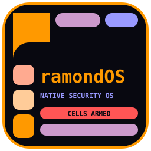

# ramondOS

A from-scratch native x86 operating system for reverse engineering, vulnerability research and threat hunting. It denies everything by default and records everything it allows.

- **Default-deny cells:** programs run in ring 3 with only the capabilities they are granted.
- **Learn mode:** see what a program asks for; sensitive requests are logged, never executed.
- **Hash-chained audit log:** a SHA-256 chain makes tampering detectable.
- **Relay-only network:** one narrow door to the host; API keys never live inside the OS.
- **Built-in analysis:** x86 disassembler, a 32-bit Windows PE emulator, and Ghidra headless analysis through the relay.
- **Unix-style layer:** preemptive multitasking, fork/exec, pipes, signals, a shell and a small C library.

Run it in a virtual machine (QEMU or VirtualBox). It is a research system and has not been hardened for bare metal.

## Documentation

- Website: see `index.html` (served by GitHub Pages)
- Full documentation: [docs/DOCUMENTATION.md](docs/DOCUMENTATION.md)
- In-OS README: [docs/ramondOS-Readme.txt](docs/ramondOS-Readme.txt)

## Logos

`assets/logo.svg`, `assets/logo-wordmark.svg`
